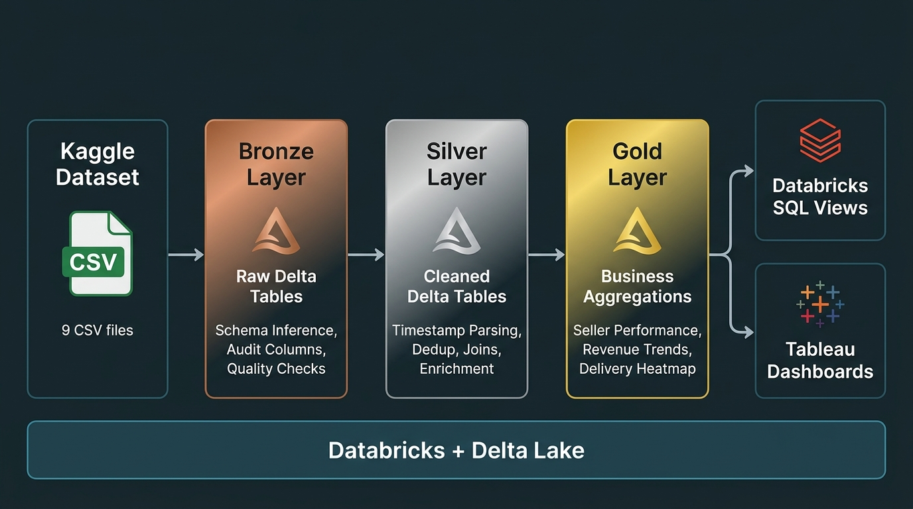

# 🛒 E-Commerce Data Pipeline — PySpark on Databricks

An end-to-end data engineering pipeline built with **PySpark** and **Databricks**, implementing the **Medallion Architecture** (Bronze → Silver → Gold) on the [Olist Brazilian E-Commerce dataset](https://www.kaggle.com/datasets/olistbr/brazilian-ecommerce) from Kaggle.

The pipeline processes **100K+ real orders** across 9 relational tables, progressively refining them through three layers of **Delta Lake** tables before surfacing insights via **Databricks SQL views** and interactive **Tableau** dashboards.

---

## 🏗️ Architecture



**Data flows through four stages:**

| Stage | What Happens |
|---|---|
| **Bronze** | Raw CSV ingestion with schema inference, audit columns (`_ingested_at`, `_source_file`), and data quality checks |
| **Silver** | Timestamp parsing, null handling, deduplication, payment aggregation, English category enrichment, master table join |
| **Gold** | Business aggregations — seller scorecards, monthly revenue trends, state distributions, delivery heatmaps, category rankings |
| **SQL Views** | Enriched views with seller tiers, cumulative revenue, revenue share %, delivery risk levels |

---

## 📊 Tableau Dashboard

🔗 [View on Tableau Public](https://public.tableau.com/views/BrazilianE-CommerceAnalytics/E-CommerceAnalyticsStory)

**Three dashboard pages:**
- **Revenue Overview** — Monthly revenue by top 10 categories, category revenue vs. review scores
- **Seller Performance** — Seller tier distribution, revenue vs. review scatter plot
- **Delivery & Geography** — Revenue choropleth by state, late delivery risk by seller city

---

## 📁 Project Structure

```
ecommerce-data-pipeline/
│
├── notebooks/
│   ├── 01_bronze_ingestion.py      # CSV → Delta, audit columns, PK/dup checks
│   ├── 02_silver_cleaning.py       # Timestamps, dedup, joins, enrichment
│   ├── 03_gold_aggregations.py     # 5 business aggregation tables
│   ├── 04_sql_views.py             # SQL views with tiers, windows, risk levels
│   └── 05_export_to_tableau.py     # Export Gold views as CSVs for Tableau
│
├── docs/
│   └── architecture.png            # Pipeline architecture diagram
│
├── .gitignore
└── README.md
```

---

## 🔧 Tech Stack

| Component | Tool |
|---|---|
| Processing | PySpark (Databricks Runtime) |
| Storage | Delta Lake (Unity Catalog Volumes) |
| Orchestration | Databricks Notebooks |
| SQL Layer | Databricks SQL Views |
| Visualization | Tableau Public |
| Source Data | Kaggle — Olist Brazilian E-Commerce |

---

## 📦 Dataset

- **Source:** [Olist Brazilian E-Commerce — Kaggle](https://www.kaggle.com/datasets/olistbr/brazilian-ecommerce)
- **Size:** 100K+ orders, 9 relational tables
- **Period:** 2016–2018

**Tables ingested:**

| Table | Primary Key | Records |
|---|---|---|
| `orders` | `order_id` | 99,441 |
| `order_items` | `order_id` | 112,650 |
| `payments` | `order_id` | 103,886 |
| `reviews` | `review_id` | 100,000 |
| `customers` | `customer_id` | 99,441 |
| `sellers` | `seller_id` | 3,095 |
| `products` | `product_id` | 32,951 |
| `geolocation` | `zip_code_prefix` | 1,000,163 |
| `category_names` | `category_name` | 71 |

---

## 🥉 Bronze Layer

- Ingested all 9 CSVs into managed Delta tables
- Added lineage columns: `_ingested_at`, `_source_file`
- Ran automated quality checks: null PK detection, duplicate counts
- Registered tables in `ecommerce_bronze` database

---

## 🥈 Silver Layer

- Parsed and standardized all timestamp columns
- Derived `delivery_delay_days` and `is_late_delivery` flag
- Deduplicated reviews (kept latest per order using window functions)
- Aggregated payments to one row per order
- Joined products with English category translations
- Averaged geolocation coordinates per zip code
- Built a denormalized master table joining all entities

---

## 🥇 Gold Layer

5 aggregation tables built for analytics:

| Table | Description |
|---|---|
| `seller_performance` | Revenue, avg review, late delivery % per seller (min 5 orders) |
| `monthly_revenue` | Revenue trend by product category and month |
| `state_distribution` | Customer count and revenue by Brazilian state |
| `late_delivery_heatmap` | Late delivery % by seller city (min 10 orders) |
| `category_performance` | Revenue, order count, and avg review by product category |

---

## 📊 SQL Views

5 enriched views built on Gold tables:

- `vw_seller_performance` — Seller tier classification (Top / Average / Underperformer)
- `vw_monthly_revenue_trend` — Cumulative revenue via window function
- `vw_state_distribution` — Revenue share % per state
- `vw_late_delivery_heatmap` — Delivery risk level (Critical / High Risk / Moderate / Good)
- `vw_category_performance` — Revenue rank and share per category

---

## 💡 Key Insights

- **Health & Beauty** is the highest revenue category at ~$1.23M
- **São Paulo** accounts for ~37% of total platform revenue
- Only **18.6%** of sellers qualify as "Top Sellers"
- **Três de Maio** has the highest late delivery rate among cities
- Revenue shows clear seasonality with peaks in Q4

---

## ▶️ How to Run

1. Download the dataset from [Kaggle](https://www.kaggle.com/datasets/olistbr/brazilian-ecommerce) and upload CSVs to a Databricks Volume
2. Run notebooks in order: `01` → `02` → `03` → `04` → `05`
3. Each notebook builds on the previous layer's output
4. Query Gold tables via Databricks SQL or export CSVs for Tableau

---

## 📄 License

This project uses the [Olist Brazilian E-Commerce Public Dataset](https://www.kaggle.com/datasets/olistbr/brazilian-ecommerce) (CC BY-NC-SA 4.0).
